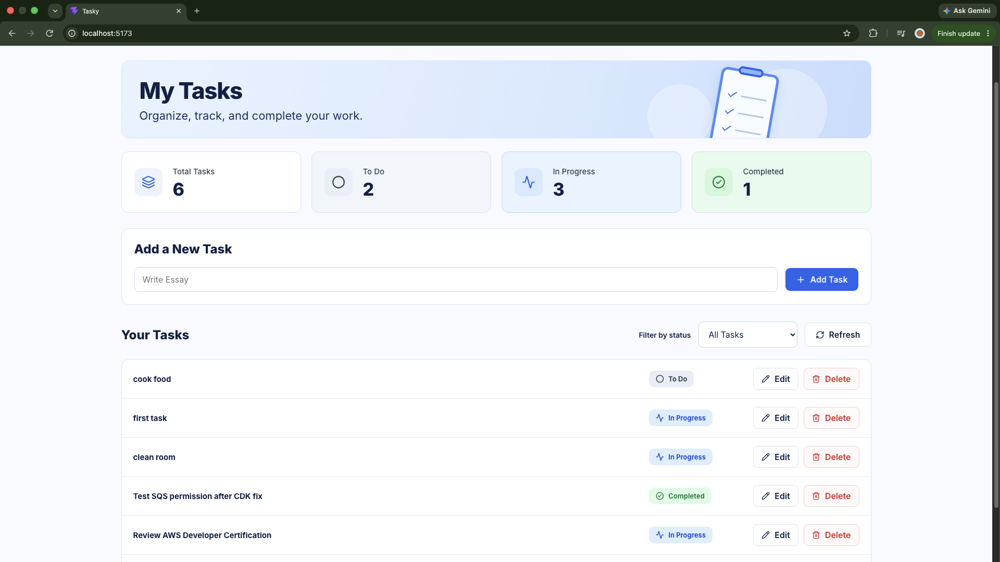

# Serverless Task Management Frontend

A completed React and TypeScript web application for managing tasks through the Serverless Task Management API. Users can sign in, search and sort tasks, filter by status, and create, view, edit, and delete tasks.

## Project Goals

- Provide a simple web interface for the task management API.
- Authenticate users with their Cognito account.
- Retrieve and display tasks belonging to the signed-in user.
- Keep API configuration in environment variables for local development and deployment.

## Architecture

```text
Browser
   |
   v
React + TypeScript application
   |                    |
   v                    v
Amazon Cognito      Task API (API Gateway)
                         |
                         v
                   Task data response
```

**Request flow:**

1. The user signs in with their Cognito username and password.
2. AWS Amplify manages the Cognito session.
3. The frontend obtains the session ID token and sends it to the task API.
4. The API returns the authenticated user's tasks. The frontend supports task search, sorting, status filtering, creation, editing, and deletion.

## Project Structure

```text
frontend/
├── public/                    # Static public assets
├── src/
│   ├── services/
│   │   └── tasksApi.ts        # Authenticated task API requests
│   ├── App.tsx                # Sign-in and task dashboard UI
│   ├── App.css                # Application styles
│   ├── amplifyConfig.ts       # Cognito configuration from environment
│   ├── index.css              # Global styles
│   └── main.tsx               # React application entry point
├── .env.local                 # Local, untracked environment configuration
├── index.html                 # Vite HTML entry point
├── package.json               # Dependencies and npm scripts
├── tsconfig*.json             # TypeScript configuration
└── vite.config.ts             # Vite configuration
```

## User Interface



## Local Development Setup

### Prerequisites

- Node.js (version supported by the installed Vite release)
- npm
- Access to a configured Cognito user pool and the deployed task API

### 1. Install dependencies

From the `task-frontend/frontend` directory:

```bash
npm install
```

### 2. Configure environment variables

Create `.env.local` in the `frontend` directory:

```dotenv
VITE_API_URL=https://<api-id>.execute-api.<region>.amazonaws.com/<stage>/tasks
VITE_COGNITO_USER_POOL_ID=<region>_<user-pool-id>
VITE_COGNITO_CLIENT_ID=<user-pool-client-id>
VITE_AWS_REGION=<region>
```

### 3. Start the development server

```bash
npm run dev
```

Open the local URL printed by Vite: `http://localhost:5173`

## Available Commands

```bash
npm run dev      # Start the local development server
npm run lint     # Run ESLint
npm run build    # Type-check and create a production build in dist/
npm run preview  # Preview the production build locally
```

## Current Functionality

- Cognito username and password sign-in.
- Session restoration when the application loads.
- Authenticated retrieval and display of the signed-in user's tasks.
- Search and sort tasks.
- Filter tasks by status.
- Create tasks.
- Edit task titles and statuses.
- Delete tasks.
- Sign-out and task-list refresh.

## Project Status

The frontend is complete for its current scope and ready to run against a configured deployment of the task API. It provides authentication and full task management, including search, sorting, and status filtering. Setup and build commands are documented above.
